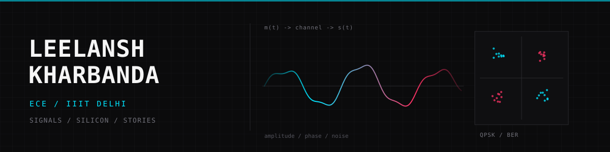

# Leelansh Kharbanda

B.Tech in Electronics and Communication Engineering at IIIT Delhi. Most of my projects start with a signal or an instruction set and end with something you can run: a wireless channel you can watch, a RISC-V program you can trace, a modem you can listen to.

[Email](mailto:leelansh24319@iiitd.ac.in) · [LinkedIn](https://linkedin.com/in/leelansh-kharbanda) · [Modulation Studio](https://breaking-byts.github.io/Modulation-Studio/) · [Tasveer](https://breaking-byts.github.io/tasveer/)

Tools I keep coming back to: C, C++, Rust, Elixir, Python, TypeScript, Java.

## What I've built

| Project | What it does |
| --- | --- |
| [Chronos-DSP](https://github.com/breaking-byts/Chronos-DSP) | A 3D wireless channel you can drive in a browser. Line of sight, specular reflections, knife-edge diffraction, Doppler and material loss feed a QPSK baseband with seeded AWGN and BER plots. Elixir and Phoenix run the control plane; a Rust NIF does the DSP, with a pure Elixir fallback. There is a JSON API and CSV export for running it headless. |
| [MoE Memory Wall](https://github.com/breaking-byts/MoE-Memory-Wall-CA-Project) | A course project on serving Mixtral-8x7B when the experts do not fit in HBM. The predictor is training-free and reached 0.943 top-2 recall; the prefetcher gave 1.27-1.28x over on-demand plus LRU when HBM was tight. It is all simulated, so it runs without a GPU. |
| [Life OS](https://github.com/breaking-byts/Life-Os) | A desktop app that keeps your data on your machine. Tauri 2, React 19 and SQLite underneath; ONNX Runtime for local inference and LanceDB for semantic memory, behind 80+ command handlers. |
| [Modulation Studio](https://github.com/breaking-byts/Modulation-Studio) | Eight digital modulation schemes with FFT and constellation views, adjustable channel impairment, side-by-side comparison, presets and CSV/PNG export. [Live demo](https://breaking-byts.github.io/Modulation-Studio/). |
| [RV32I sandbox](https://github.com/breaking-byts/RISC-V-Assembler-and-Simulator) | A two-pass assembler and simulator for the RISC-V RV32I subset, with label resolution, all 32 registers, and a trace of PC and register state after each instruction. |
| [Tasveer](https://github.com/breaking-byts/tasveer) | The website for IIIT Delhi's media society. Static files, no build step, self-hosted animation libraries, and a reduced-motion path that keeps the content readable. [Live site](https://breaking-byts.github.io/tasveer/). |

## Research

Bare-metal anomaly detection, advised by Dr. Sujay Deb. I sequence CPU telemetry from the 400K-sample RaDaR dataset through an LSTM, getting about 0.90 balanced accuracy, and spend the rest of the time on the feature-extraction pipeline that decides how much this costs on the device itself.

HPC-Boost looks at the same problem from the hardware security side: LSTM forecasters and classifiers over performance-counter logs to catch runtime attacks, with XGBoost and Isolation Forest used to drop telemetry channels that do not help.

## Around campus

I coordinate Tasveer, the media society here, and shoot for it as well. The crew page pairs every portrait with the same person as a kid. That is my favourite part of the site and the reason I care about the small details of an editorial layout.

## Open to

Research collaborations on edge inference, signal pipelines and hardware telemetry. If you are working on something in that space, or on photography and editorial design, I would like to hear about it.
